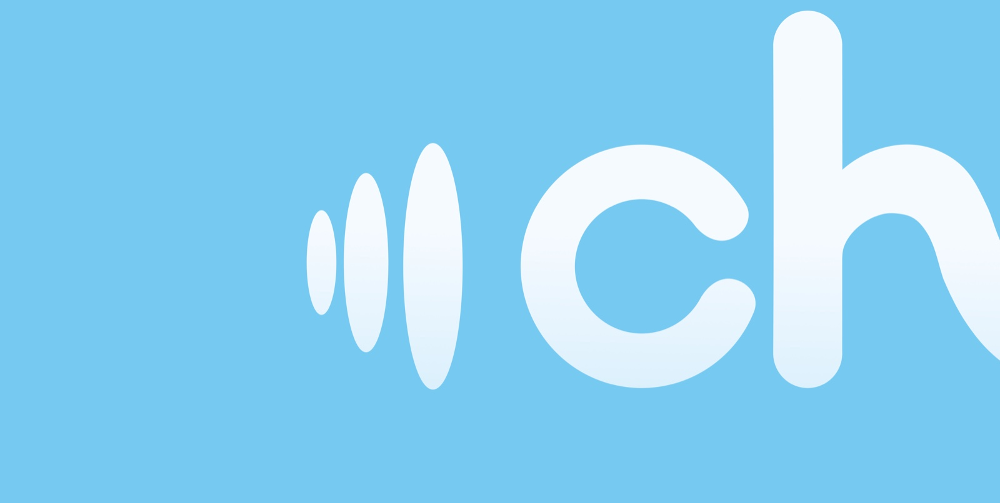
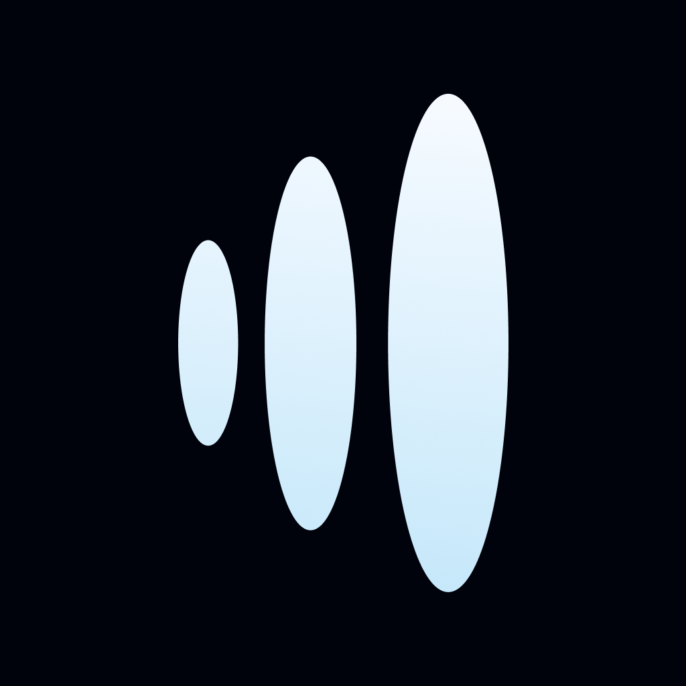

<h1 align="center">chic</h1>

<strong>소리를 보고, 진동으로 느끼는 스티밍 연습</strong>

청각장애인 초보 바리스타가 우유 스티밍의 현재 상태를 스스로 알아차리고, 다음 한 잔을 준비할 수 있도록 돕는 iPhone · Apple Watch 앱입니다.

<a href="https://developeracademy-postech.github.io/2026-C6-A04-BEANDOONG/">프로젝트 웹사이트</a> · <a href="#chic이-하는-일">앱 살펴보기</a> · <a href="#team-beandoong">팀 소개</a>

---

## 왜 만들었나요?

바리스타는 우유의 움직임을 보고, 피처의 온도를 느끼고, 스티밍 소리를 들으며 공기 주입 상태를 판단합니다. 소리를 듣기 어려운 초보 바리스타도 **지금 무엇이 일어나는지 알고 스스로 조절할 수 있도록**, chic은 소리의 단서를 시각과 진동으로 옮깁니다.

> **소리를 넘어, 나만의 한 잔으로.**

## chic이 하는 일

| 01 · 준비 | 02 · 연습 | 03 · 돌아보기 |
| :--- | :--- | :--- |
| 마이크 권한과 연습 순서를 확인하고 스티밍을 준비합니다. | iPhone에서 소리를 실시간으로 분석해 상태와 다음 행동을 짧게 보여줍니다. 연결된 Apple Watch는 상태 변화를 진동으로 알립니다. | 연습 결과에서 소리별 시간과 가이드를 확인하고, 지난 기록을 다시 볼 수 있습니다. |

| 공기 주입 | 큰 기포 | 공기 부족 | 안정적인 롤링 |
| :---: | :---: | :---: | :---: |
|  |  |  |  |

색상만으로 상태를 구분하지 않고, 일러스트와 짧은 문장을 함께 사용합니다. Apple Watch가 없어도 iPhone에서 연습할 수 있습니다.

## 어떻게 동작하나요?

`마이크 입력` → `온디바이스 소리 분석` → `실시간 화면 피드백` → `Apple Watch 진동` → `연습 결과·기록`

- **iPhone:** SwiftUI, AVAudioEngine, Core ML, SwiftData
- **Apple Watch:** SwiftUI, WatchConnectivity, 햅틱 피드백
- **데이터:** 마이크 소리는 실시간 분석에 사용하며, 새 연습의 원음 파일을 저장하지 않습니다. 연습 기록은 기기 안의 SwiftData에 저장합니다.

설계와 구현을 더 자세히 보려면 [소리 분석](docs/steaming-sound-model.md), [연습 결과와 데이터](docs/practice-results.md), [iPhone ↔ Apple Watch 연결](docs/watch-connectivity.md)을 참고하세요.

## 실행하기

1. Xcode 27 이상에서 `chic.xcodeproj`를 엽니다.
2. `chic` 스킴을 선택하고 iPhone에서 빌드·실행합니다. 프로젝트의 iOS 최소 버전은 **27.0**입니다.
3. 마이크 사용을 허용한 뒤 홈 화면에서 **연습하기**를 선택합니다.
4. Apple Watch 진동을 사용하려면 워치 앱을 설치하고 앱의 **설정 → 워치 페어링**에서 연결합니다. 워치 앱의 최소 버전은 **watchOS 10.6**입니다.

기기에서 실행할 때는 Xcode의 Signing & Capabilities에서 자신의 개발 팀과 서명 설정을 확인하세요. 웹 소개 페이지는 앱 빌드 없이 [별도로 미리 볼 수 있습니다](docs/website.md).

## Team BEANDOONG

서로 다른 감각이 모여, 더 많은 사람이 스스로 배울 수 있는 경험을 만듭니다.

|  |  |  |
| :---: | :---: | :---: |
|  <b>메이플 · Maple</b> PM |  <b>크레이그 · Craig</b> Developer |  <b>에스터 · Esther</b> Developer |
|  <b>앤 · Ann</b> Designer |  <b>레미 · Remi</b> Developer |  <b>젠 · Jen</b> Designer |

Apple Developer Academy @ POSTECH · 2026

---

<strong>A new sense of steaming.</strong>

